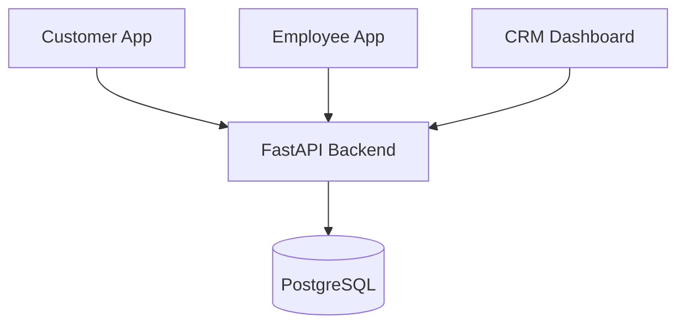
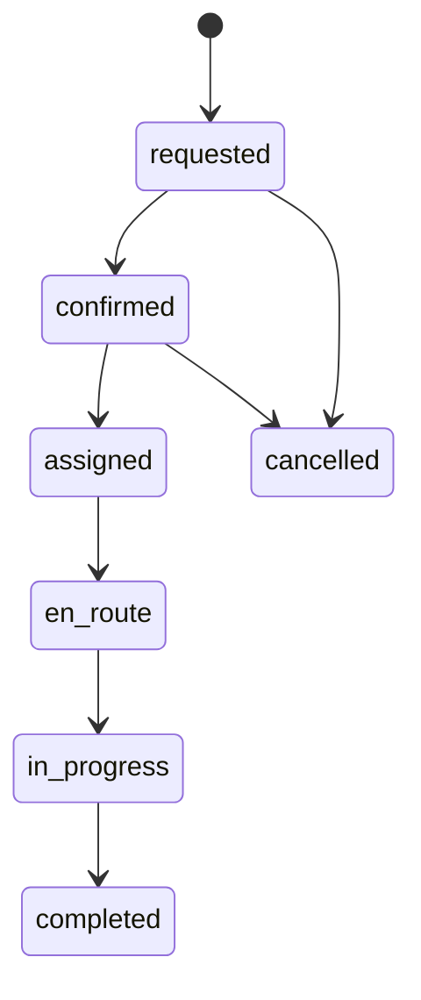

<p align="center"></p>

<p align="center">
<a href="https://github.com/carsherss/app/actions/workflows/ci.yml"></a>
<a href="https://github.com/carsherss/app/actions/workflows/android-customer.yml"></a>
<a href="https://github.com/carsherss/app/actions/workflows/android-employee.yml"></a>
</p>

# CARSHERS
Doorstep car and bike washing platform. **v0.1.1 targets two standalone Android release APKs that launch without Metro.**

> **Status:** v0.1.1 In progress. Complete only after CI checks and physical-device tests.

## Assets
- Logo placeholder: `docs/assets/logo.png` (add approved logo).
- Screenshots placeholder: `docs/assets/screenshots/` (add real device screenshots after testing).
- Static hero: `docs/assets/hero.svg`.

## Feature status
| Feature | Status |
|---|---|
| Customer standalone APK | v0.1.1 done-when-verified |
| Employee standalone APK | v0.1.1 done-when-verified |
| Bundle/signature/package/version checks | v0.1.1 done-when-verified |
| Physical-device and airplane-mode launch | Planned / owner test required |
| Registration, vehicles, services, booking | Planned |
| Employee job assignment | Planned |
| Photos, notifications, payments | Planned |
| Backend and CRM production features | Planned |

## Architecture



These diagrams describe intended architecture and a future lifecycle; they are not implemented features in v0.1.1.

## Repository layout
```text
.github/workflows/   Existing CI plus app-specific Android workflows
apps/customer/       Customer Expo app
apps/employee/       Employee Expo app
apps/crm/            Existing CRM; out of scope
apps/api/            Existing API; out of scope
scripts/             Bootstrap and APK verification
docs/                ADRs, release and device testing
BRAIN.md             Engineering source of truth
ROADMAP.md           Versioned milestones
VERIFY.md            Owner verification record
```

## Technology baseline
| Component | Baseline | Official source checked 2026-10-30 |
|---|---|---|
| Expo | SDK 58, package range `~58.0.0` | https://docs.expo.dev/versions/latest/ |
| React Native | 0.88 | Same Expo compatibility table |
| React | 19.3.0 | Same Expo compatibility table |
| Node | 22.13.x minimum | Same Expo compatibility table |
| Java | Temurin JDK 17 selected for CI | Workflow configuration; owner must validate |

The exact Expo patch and transitive dependency resolution are captured in owner-generated lockfiles.

## Prerequisites and bootstrap
Node.js 22.13.x+, npm, Git; JDK 17 and Android SDK/build-tools for local native builds. From repository root:
```bash
bash scripts/bootstrap-mobile.sh
```
Review and commit both `package.json` and `package-lock.json` files. Do not commit generated `android/` folders.

## Android release build
Inside each app directory:
```bash
npx expo-doctor
npx expo prebuild --clean --platform android
cd android
./gradlew --no-daemon :app:assembleRelease
```
Expected output: `android/app/build/outputs/apk/release/app-release.apk`.

## Verify locally
From repository root (Android SDK env configured):
```bash
bash scripts/verify-apk.sh apps/customer/android/app/build/outputs/apk/release/app-release.apk com.carshers.customer 101
bash scripts/verify-apk.sh apps/employee/android/app/build/outputs/apk/release/app-release.apk com.carshers.employee 101
```
The verifier checks bundle, signature, package, versionCode and debuggable status and writes a SHA-256 file.

## Download GitHub artifacts
1. Open https://github.com/carsherss/app and select **Actions**.
2. Open the Customer or Employee Android Release APK workflow.
3. Select a completed run and scroll to **Artifacts**.
4. Download `carshers-customer-0.1.1-release-apk` or `carshers-employee-0.1.1-release-apk`.
5. Extract the artifact ZIP; it contains the APK and `.sha256` checksum.

## Signing
v0.1.1 uses generated debug-style signing for internal testing only. It is not a production Play release. Production signing is deferred to v0.2.0.

## Docs
- [BRAIN](BRAIN.md) · [ROADMAP](ROADMAP.md) · [CHANGELOG](CHANGELOG.md) · [VERIFY](VERIFY.md)
- [Android release instructions](docs/release/ANDROID_RELEASE.md)
- [Device acceptance checklist](docs/testing/DEVICE_TEST_v0.1.1.md)
- [Security](SECURITY.md) · [Contributing](CONTRIBUTING.md) · [Third-party notices](THIRD_PARTY_NOTICES.md)

## License
Proprietary — All Rights Reserved. Draft requires legal review. Third-party components remain under their own licenses.
